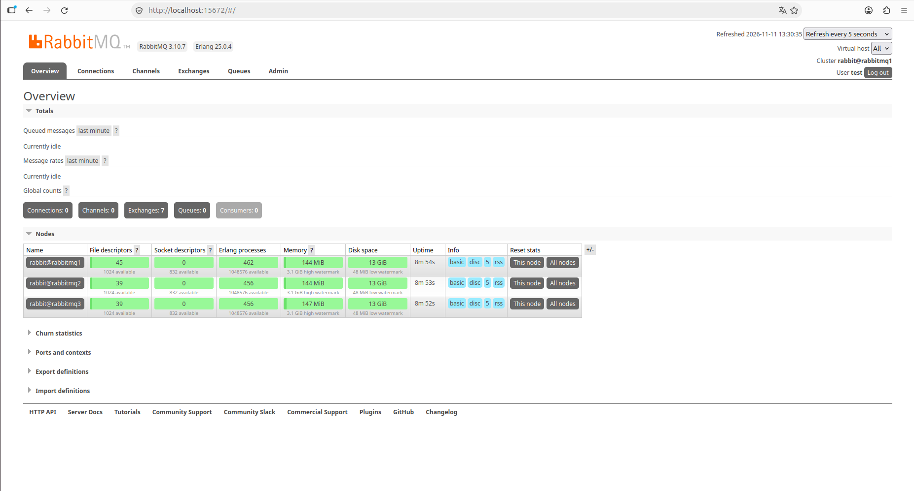
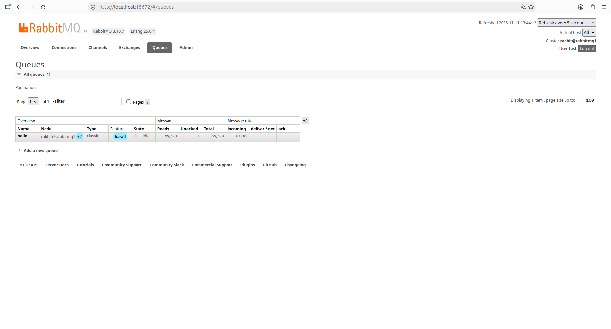
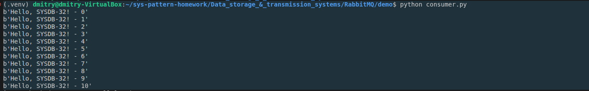
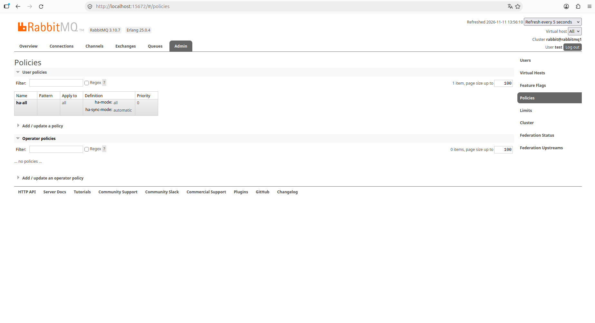

# Домашнее задание к занятию  «Очереди RabbitMQ»


### Задание 1. Установка RabbitMQ

Используя Vagrant или VirtualBox, создайте виртуальную машину и установите RabbitMQ.
Добавьте management plug-in и зайдите в веб-интерфейс.

*Итогом выполнения домашнего задания будет приложенный скриншот веб-интерфейса RabbitMQ.*

### Ответ



---

### Задание 2. Отправка и получение сообщений

Используя приложенные скрипты, проведите тестовую отправку и получение сообщения.
Для отправки сообщений необходимо запустить скрипт producer.py.

Для работы скриптов вам необходимо установить Python версии 3 и библиотеку Pika.
Также в скриптах нужно указать IP-адрес машины, на которой запущен RabbitMQ, заменив localhost на нужный IP.

```shell script
$ pip install pika
```

Зайдите в веб-интерфейс, найдите очередь под названием hello и сделайте скриншот.
После чего запустите второй скрипт consumer.py и сделайте скриншот результата выполнения скрипта

*В качестве решения домашнего задания приложите оба скриншота, сделанных на этапе выполнения.*

### Ответ





---

### Задание 3. Подготовка HA кластера

Используя Vagrant или VirtualBox, создайте вторую виртуальную машину и установите RabbitMQ.
Добавьте в файл hosts название и IP-адрес каждой машины, чтобы машины могли видеть друг друга по имени.

Пример содержимого hosts файла:
```shell script
$ cat /etc/hosts
192.168.0.10 rmq01
192.168.0.11 rmq02
```
После этого ваши машины могут пинговаться по имени.

Затем объедините две машины в кластер и создайте политику ha-all на все очереди.

*В качестве решения домашнего задания приложите скриншоты из веб-интерфейса с информацией о доступных нодах в кластере и включённой политикой.*

### Ответ




Также приложите вывод команды с двух нод:

```shell script
$ rabbitmqctl cluster_status
```
### Ответ
```
Cluster status of node rabbit@rabbitmq2 ...
Basics

Cluster name: rabbit@rabbitmq2

Disk Nodes

rabbit@rabbitmq1
rabbit@rabbitmq2
rabbit@rabbitmq3

Running Nodes

rabbit@rabbitmq1
rabbit@rabbitmq2
rabbit@rabbitmq3

Versions

rabbit@rabbitmq1: RabbitMQ 3.10.7 on Erlang 25.0.4
rabbit@rabbitmq2: RabbitMQ 3.10.7 on Erlang 25.0.4
rabbit@rabbitmq3: RabbitMQ 3.10.7 on Erlang 25.0.4

Maintenance status

Node: rabbit@rabbitmq1, status: not under maintenance
Node: rabbit@rabbitmq2, status: not under maintenance
Node: rabbit@rabbitmq3, status: not under maintenance

Alarms

(none)

Network Partitions

(none)

Listeners

Node: rabbit@rabbitmq1, interface: [::], port: 15672, protocol: http, purpose: HTTP API
Node: rabbit@rabbitmq1, interface: [::], port: 61613, protocol: stomp, purpose: STOMP
Node: rabbit@rabbitmq1, interface: [::], port: 1883, protocol: mqtt, purpose: MQTT
Node: rabbit@rabbitmq1, interface: [::], port: 15692, protocol: http/prometheus, purpose: Prometheus exporter API over HTTP
Node: rabbit@rabbitmq1, interface: [::], port: 25672, protocol: clustering, purpose: inter-node and CLI tool communication
Node: rabbit@rabbitmq1, interface: [::], port: 5672, protocol: amqp, purpose: AMQP 0-9-1 and AMQP 1.0
Node: rabbit@rabbitmq2, interface: [::], port: 15672, protocol: http, purpose: HTTP API
Node: rabbit@rabbitmq2, interface: [::], port: 61613, protocol: stomp, purpose: STOMP
Node: rabbit@rabbitmq2, interface: [::], port: 1883, protocol: mqtt, purpose: MQTT
Node: rabbit@rabbitmq2, interface: [::], port: 15692, protocol: http/prometheus, purpose: Prometheus exporter API over HTTP
Node: rabbit@rabbitmq2, interface: [::], port: 25672, protocol: clustering, purpose: inter-node and CLI tool communication
Node: rabbit@rabbitmq2, interface: [::], port: 5672, protocol: amqp, purpose: AMQP 0-9-1 and AMQP 1.0
Node: rabbit@rabbitmq3, interface: [::], port: 15672, protocol: http, purpose: HTTP API
Node: rabbit@rabbitmq3, interface: [::], port: 61613, protocol: stomp, purpose: STOMP
Node: rabbit@rabbitmq3, interface: [::], port: 1883, protocol: mqtt, purpose: MQTT
Node: rabbit@rabbitmq3, interface: [::], port: 15692, protocol: http/prometheus, purpose: Prometheus exporter API over HTTP
Node: rabbit@rabbitmq3, interface: [::], port: 25672, protocol: clustering, purpose: inter-node and CLI tool communication
Node: rabbit@rabbitmq3, interface: [::], port: 5672, protocol: amqp, purpose: AMQP 0-9-1 and AMQP 1.0

Feature flags

Flag: classic_mirrored_queue_version, state: enabled
Flag: drop_unroutable_metric, state: enabled
Flag: empty_basic_get_metric, state: enabled
Flag: implicit_default_bindings, state: enabled
Flag: maintenance_mode_status, state: enabled
Flag: quorum_queue, state: enabled
Flag: stream_queue, state: enabled
Flag: user_limits, state: enabled
Flag: virtual_host_metadata, state: enabled
```

```
Cluster status of node rabbit@rabbitmq1 ...
Basics

Cluster name: rabbit@rabbitmq1

Disk Nodes

rabbit@rabbitmq1
rabbit@rabbitmq2
rabbit@rabbitmq3

Running Nodes

rabbit@rabbitmq1
rabbit@rabbitmq2
rabbit@rabbitmq3

Versions

rabbit@rabbitmq1: RabbitMQ 3.10.7 on Erlang 25.0.4
rabbit@rabbitmq2: RabbitMQ 3.10.7 on Erlang 25.0.4
rabbit@rabbitmq3: RabbitMQ 3.10.7 on Erlang 25.0.4

Maintenance status

Node: rabbit@rabbitmq1, status: not under maintenance
Node: rabbit@rabbitmq2, status: not under maintenance
Node: rabbit@rabbitmq3, status: not under maintenance

Alarms

(none)

Network Partitions

(none)

Listeners

Node: rabbit@rabbitmq1, interface: [::], port: 15672, protocol: http, purpose: HTTP API
Node: rabbit@rabbitmq1, interface: [::], port: 61613, protocol: stomp, purpose: STOMP
Node: rabbit@rabbitmq1, interface: [::], port: 1883, protocol: mqtt, purpose: MQTT
Node: rabbit@rabbitmq1, interface: [::], port: 15692, protocol: http/prometheus, purpose: Prometheus exporter API over HTTP
Node: rabbit@rabbitmq1, interface: [::], port: 25672, protocol: clustering, purpose: inter-node and CLI tool communication
Node: rabbit@rabbitmq1, interface: [::], port: 5672, protocol: amqp, purpose: AMQP 0-9-1 and AMQP 1.0
Node: rabbit@rabbitmq2, interface: [::], port: 15672, protocol: http, purpose: HTTP API
Node: rabbit@rabbitmq2, interface: [::], port: 61613, protocol: stomp, purpose: STOMP
Node: rabbit@rabbitmq2, interface: [::], port: 1883, protocol: mqtt, purpose: MQTT
Node: rabbit@rabbitmq2, interface: [::], port: 15692, protocol: http/prometheus, purpose: Prometheus exporter API over HTTP
Node: rabbit@rabbitmq2, interface: [::], port: 25672, protocol: clustering, purpose: inter-node and CLI tool communication
Node: rabbit@rabbitmq2, interface: [::], port: 5672, protocol: amqp, purpose: AMQP 0-9-1 and AMQP 1.0
Node: rabbit@rabbitmq3, interface: [::], port: 15672, protocol: http, purpose: HTTP API
Node: rabbit@rabbitmq3, interface: [::], port: 61613, protocol: stomp, purpose: STOMP
Node: rabbit@rabbitmq3, interface: [::], port: 1883, protocol: mqtt, purpose: MQTT
Node: rabbit@rabbitmq3, interface: [::], port: 15692, protocol: http/prometheus, purpose: Prometheus exporter API over HTTP
Node: rabbit@rabbitmq3, interface: [::], port: 25672, protocol: clustering, purpose: inter-node and CLI tool communication
Node: rabbit@rabbitmq3, interface: [::], port: 5672, protocol: amqp, purpose: AMQP 0-9-1 and AMQP 1.0

Feature flags

Flag: classic_mirrored_queue_version, state: enabled
Flag: drop_unroutable_metric, state: enabled
Flag: empty_basic_get_metric, state: enabled
Flag: implicit_default_bindings, state: enabled
Flag: maintenance_mode_status, state: enabled
Flag: quorum_queue, state: enabled
Flag: stream_queue, state: enabled
Flag: user_limits, state: enabled
Flag: virtual_host_metadata, state: enabled
```

Для закрепления материала снова запустите скрипт producer.py и приложите скриншот выполнения команды на каждой из нод:

```shell script
$ rabbitmqadmin get queue='hello'
```

После чего попробуйте отключить одну из нод, желательно ту, к которой подключались из скрипта, затем поправьте параметры подключения в скрипте consumer.py на вторую ноду и запустите его.

*Приложите скриншот результата работы второго скрипта.*

### Ответ
```
dmitry@dmitry-VirtualBox:~/sys-pattern-homework/Data_storage_&_transmission_systems/RabbitMQ$ docker compose exec rabbitmq1 rabbitmqctl list_queues name messages
Timeout: 60.0 seconds ...
Listing queues for vhost / ...
name    messages
hello   49770
dmitry@dmitry-VirtualBox:~/sys-pattern-homework/Data_storage_&_transmission_systems/RabbitMQ$ docker compose exec rabbitmq2 rabbitmqctl list_queues name messages
Timeout: 60.0 seconds ...
Listing queues for vhost / ...
name    messages
hello   49770
dmitry@dmitry-VirtualBox:~/sys-pattern-homework/Data_storage_&_transmission_systems/RabbitMQ$ docker compose exec rabbitmq3 rabbitmqctl list_queues name messages
Timeout: 60.0 seconds ...
Listing queues for vhost / ...
name    messages
hello   49770
```
```
dmitry@dmitry-VirtualBox:~/sys-pattern-homework/Data_storage_&_transmission_systems/RabbitMQ/demo$ docker compose ps
NAME                   IMAGE                        COMMAND                  SERVICE     CREATED          STATUS          PORTS
rabbitmq-rabbitmq2-1   rabbitmq:3.10.7-management   "docker-entrypoint.s…"   rabbitmq2   14 seconds ago   Up 6 seconds    4369/tcp, 5671/tcp, 15671-15672/tcp, 15691-15692/tcp, 25672/tcp, 0.0.0.0:5673->5672/tcp, [::]:5673->5672/tcp
rabbitmq-rabbitmq3-1   rabbitmq:3.10.7-management   "docker-entrypoint.s…"   rabbitmq3   55 minutes ago   Up 55 minutes   4369/tcp, 5671-5672/tcp, 15671-15672/tcp, 15691-15692/tcp, 25672/tcp

(.venv) dmitry@dmitry-VirtualBox:~/sys-pattern-homework/Data_storage_&_transmission_systems/RabbitMQ/demo$ python consumer.py
b'Hello, SYSDB-32! - 35550'
b'Hello, SYSDB-32! - 35551'
b'Hello, SYSDB-32! - 35552'
b'Hello, SYSDB-32! - 35553'
b'Hello, SYSDB-32! - 35554'
b'Hello, SYSDB-32! - 35555'
b'Hello, SYSDB-32! - 35556'
b'Hello, SYSDB-32! - 35557'
b'Hello, SYSDB-32! - 35558'
```

## Дополнительные задания (со звёздочкой*)
Эти задания дополнительные, то есть не обязательные к выполнению, и никак не повлияют на получение вами зачёта по этому домашнему заданию. Вы можете их выполнить, если хотите глубже шире разобраться в материале.

### * Задание 4. Ansible playbook

Напишите плейбук, который будет производить установку RabbitMQ на любое количество нод и объединять их в кластер.
При этом будет автоматически создавать политику ha-all.

*Готовый плейбук разместите в своём репозитории.*
