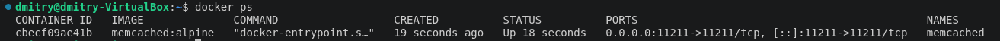
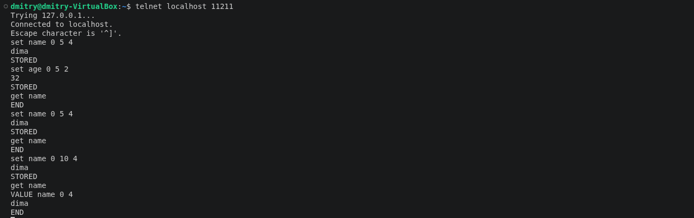
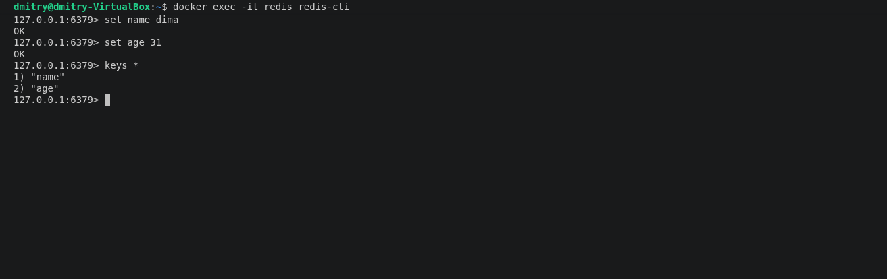
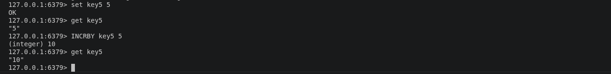

# Практическое задание с самопроверкой «Кеширование Redis/memcached»

## Задание 1. Кеширование

Приведите примеры проблем, которые может решить кеширование.

Приведите ответ в свободной форме.

## Ответ

 Часто запрашиваемые данные хранят в быстром хранилище. Запросы идут в кеш, а не в БД. В результате нагрузка на БД снижается в разы, система остаётся стабильной даже при высоких RPS.

## Задание 2. Memcached

Установите и запустите memcached.

Приведите скриншот systemctl status memcached, где будет видно, что memcached запущен.

## Ответ

## Задание 3. Удаление по TTL в Memcached

Запишите в memcached несколько ключей с любыми именами и значениями, для которых выставлен TTL 10.

Приведите скриншот, на котором видно, что спустя 10 секунд ключи удалились из базы.

## Ответ

## Задание 4. Запись данных в Redis

Запишите в Redis несколько ключей с любыми именами и значениями.

Через redis-cli достаньте все записанные ключи и значения из базы, приведите скриншот этой операции.

## Ответ

Дополнительные задания (со звёздочкой)*
Эти задания дополнительные, то есть не обязательные к выполнению. Вы можете их выполнить, если хотите глубже разобраться в материале.

## Задание 5. Работа с числами*

Запишите в Redis ключ key5 со значением типа “int” равным числу 5. Увеличьте его на 5, чтобы в итоге в значении лежало число 10.

Приведите скриншот, где будут проделаны все операции и будет видно, что значение key5 стало равно 10.

## Ответ

