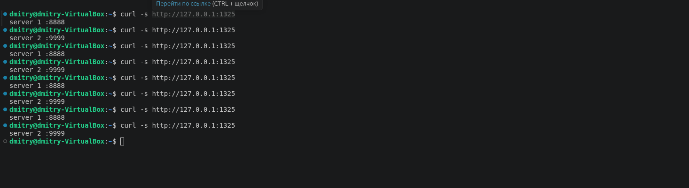
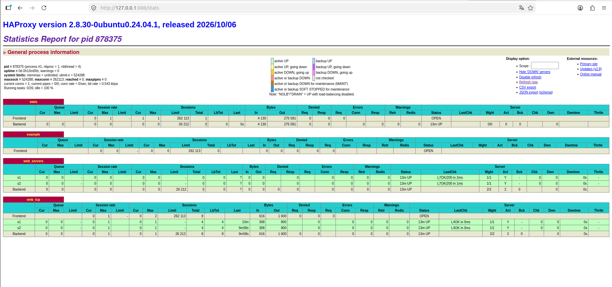
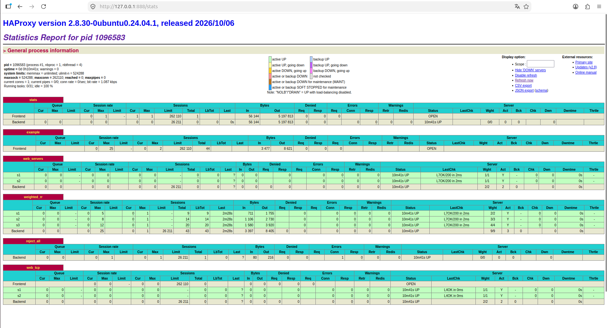
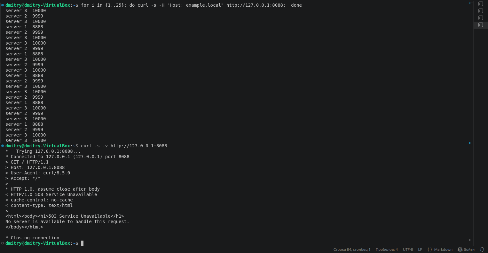
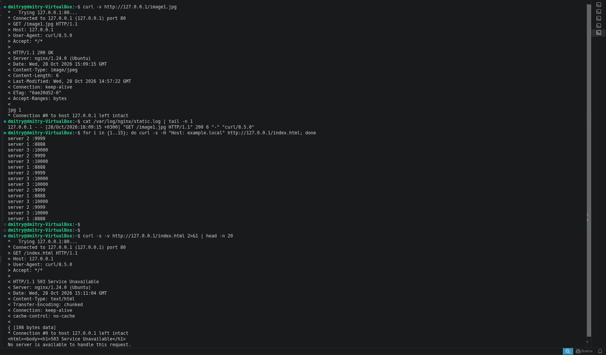
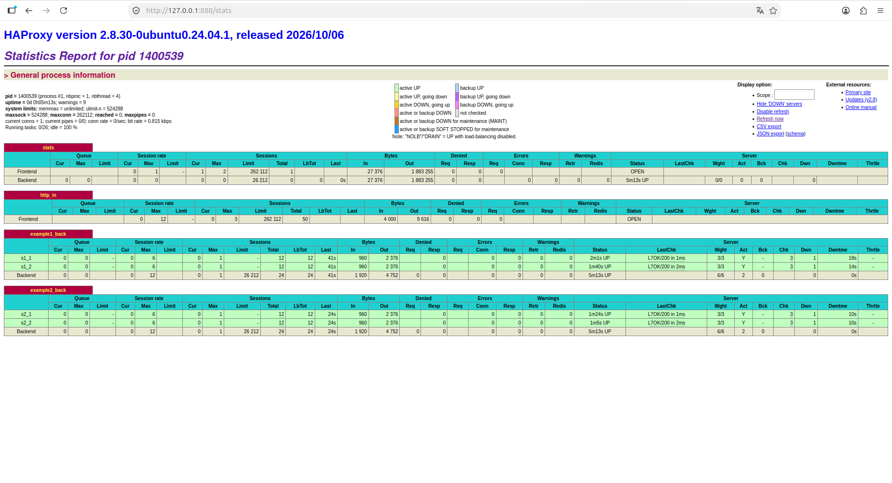
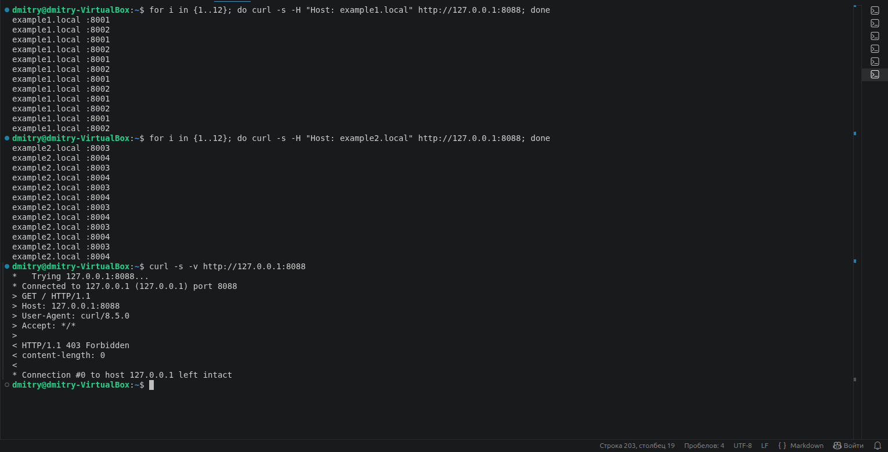

# Домашнее задание к занятию 2 «Кластеризация и балансировка нагрузки»

## Задание 1

    Запустите два simple python сервера на своей виртуальной машине на разных портах
    Установите и настройте HAProxy, воспользуйтесь материалами к лекции по ссылке
    Настройте балансировку Round-robin на 4 уровне.
    На проверку направьте конфигурационный файл haproxy, скриншоты, где видно перенаправление запросов на разные серверы при обращении к HAProxy.

## Решение

### конфигурационный файл haproxy
```
global
	log /dev/log	local0
	log /dev/log	local1 notice
	chroot /var/lib/haproxy
	stats socket /run/haproxy/admin.sock mode 660 level admin expose-fd listeners
	stats timeout 30s
	user haproxy
	group haproxy
	daemon

	# Default SSL material locations
	ca-base /etc/ssl/certs
	crt-base /etc/ssl/private

	# See: https://ssl-config.mozilla.org/#server=haproxy&server-version=2.0.3&config=intermediate
        ssl-default-bind-ciphers ECDHE-ECDSA-AES128-GCM-SHA256:ECDHE-RSA-AES128-GCM-SHA256:ECDHE-ECDSA-AES256-GCM-SHA384:ECDHE-RSA-AES256-GCM-SHA384:ECDHE-ECDSA-CHACHA20-POLY1305:ECDHE-RSA-CHACHA20-POLY1305:DHE-RSA-AES128-GCM-SHA256:DHE-RSA-AES256-GCM-SHA384
        ssl-default-bind-ciphersuites TLS_AES_128_GCM_SHA256:TLS_AES_256_GCM_SHA384:TLS_CHACHA20_POLY1305_SHA256
        ssl-default-bind-options ssl-min-ver TLSv1.2 no-tls-tickets

defaults
	log	global
	option	dontlognull
	timeout connect 5000
	timeout client  50000
	timeout server  50000
	errorfile 400 /etc/haproxy/errors/400.http
	errorfile 403 /etc/haproxy/errors/403.http
	errorfile 408 /etc/haproxy/errors/408.http
	errorfile 500 /etc/haproxy/errors/500.http
	errorfile 502 /etc/haproxy/errors/502.http
	errorfile 503 /etc/haproxy/errors/503.http
	errorfile 504 /etc/haproxy/errors/504.http

# Веб-страница со статистикой (HTTP)
listen stats
	bind :888
	mode http
	stats enable
	stats uri /stats
	stats refresh 5s
	stats realm Haproxy\ Statistics

# Фронтенд для HTTP-балансировки
frontend example
	mode http
	bind :8088
	acl ACL_example.com hdr(host) -i example.com
	use_backend web_servers if ACL_example.com

backend web_servers
	mode http
	balance roundrobin
	option httpchk
	http-check send meth GET uri /index.html
	server s1 127.0.0.1:8888 check
	server s2 127.0.0.1:9999 check

# Балансировка Round-robin на 4-м уровне (TCP)
listen web_tcp
	bind :1325
	mode tcp
	balance roundrobin
	server s1 127.0.0.1:8888 check inter 3s rise 2 fall 3
	server s2 127.0.0.1:9999 check inter 3s rise 2 fall 3

```





## Задание 2

    Запустите три simple python сервера на своей виртуальной машине на разных портах
    Настройте балансировку Weighted Round Robin на 7 уровне, чтобы первый сервер имел вес 2, второй - 3, а третий - 4
    HAproxy должен балансировать только тот http-трафик, который адресован домену example.local
    На проверку направьте конфигурационный файл haproxy, скриншоты, где видно перенаправление запросов на разные серверы при обращении к HAProxy c использованием домена example.local и без него.


## Решение

### конфигурационный файл haproxy
```
global
        log /dev/log    local0
        log /dev/log    local1 notice
        chroot /var/lib/haproxy
        #stats socket /run/haproxy/admin.sock mode 660 level admin expose-fd listeners
        stats timeout 30s
        user haproxy
        group haproxy
        daemon

        # Default SSL material locations
        ca-base /etc/ssl/certs
        crt-base /etc/ssl/private

        # See: https://ssl-config.mozilla.org/#server=haproxy&server-version=2.0.3&config=intermediate
        ssl-default-bind-ciphers ECDHE-ECDSA-AES128-GCM-SHA256:ECDHE-RSA-AES128-GCM-SHA256:ECDHE-ECDSA-AES256-GCM-SHA384:ECDHE-RSA-AES256-GCM-SHA384:ECDHE-ECDSA-CHACHA20-POLY1305:ECDHE-RSA-CHACHA20-POLY1305:DHE-RSA-AES128-GCM-SHA256:DHE-RSA-AES256-GCM-SHA384
        ssl-default-bind-ciphersuites TLS_AES_128_GCM_SHA256:TLS_AES_256_GCM_SHA384:TLS_CHACHA20_POLY1305_SHA256
        ssl-default-bind-options ssl-min-ver TLSv1.2 no-tls-tickets

defaults
        log     global
        option  dontlognull
        timeout connect 5000
        timeout client  50000
        timeout server  50000
        errorfile 400 /etc/haproxy/errors/400.http
        errorfile 403 /etc/haproxy/errors/403.http
        errorfile 408 /etc/haproxy/errors/408.http
        errorfile 500 /etc/haproxy/errors/500.http
        errorfile 502 /etc/haproxy/errors/502.http
        errorfile 503 /etc/haproxy/errors/503.http
        errorfile 504 /etc/haproxy/errors/504.http

# Веб-страница со статистикой (HTTP)
listen stats
        bind :888
        mode http
        stats enable
        stats uri /stats
        stats refresh 5s
        stats realm Haproxy\ Statistics

# Фронтенд для HTTP-балансировки (
frontend example
        mode http
        bind :8088
        acl ACL_example.com hdr(host) -i example.com
        use_backend web_servers if ACL_example.com

        acl is_example_local hdr(host) -i example.local
        use_backend weighted_rr if is_example_local
        default_backend reject_all

backend web_servers
        mode http
        balance roundrobin
        option httpchk
        http-check send meth GET uri /index.html
        server s1 127.0.0.1:8888 check
        server s2 127.0.0.1:9999 check

# Бэкенд с Weighted Round-Robin (веса 2, 3, 4)
backend weighted_rr
        mode http
        balance roundrobin
        option httpchk GET /index.html

        server s1 127.0.0.1:8888 check weight 2
        server s2 127.0.0.1:9999 check weight 3
        server s3 127.0.0.1:10000 check weight 4

# Бэкенд для всего остального трафика (чтобы явно показать «без домена»)
backend reject_all
        mode http
        errorfile 403 /etc/haproxy/errors/403.http

listen web_tcp
        bind :1325
        mode tcp
        balance roundrobin
        server s1 127.0.0.1:8888 check inter 3s rise 2 fall 3
        server s2 127.0.0.1:9999 check inter 3s rise 2 fall 3

```





Задания со звёздочкой*

Эти задания дополнительные. Их можно не выполнять. На зачёт это не повлияет. Вы можете их выполнить, если хотите глубже разобраться в материале.
## Задание 3*

    Настройте связку HAProxy + Nginx как было показано на лекции.
    Настройте Nginx так, чтобы файлы .jpg выдавались самим Nginx (предварительно разместите несколько тестовых картинок в директории /var/www/), а остальные запросы переадресовывались на HAProxy, который в свою очередь переадресовывал их на два Simple Python server.
    На проверку направьте конфигурационные файлы nginx, HAProxy, скриншоты с запросами jpg картинок и других файлов на Simple Python Server, демонстрирующие корректную настройку.


## Решение

### конфигурационный файл nginx
```
server {
    listen 80;
    server_name _;


    location ~* \.(jpg|jpeg|png|gif)$ {
        root /var/www;
        try_files $uri =404;
        access_log /var/log/nginx/static.log;
    }


    location / {
        proxy_pass http://127.0.0.1:8088;
        proxy_set_header Host $host;
        proxy_set_header X-Real-IP $remote_addr;
        proxy_set_header X-Forwarded-For $proxy_add_x_forwarded_for;
        proxy_set_header X-Forwarded-Proto $scheme;
        access_log /var/log/nginx/proxy.log;
    }
}
```

### конфигурационный файл haproxy
```
global
        log /dev/log    local0
        log /dev/log    local1 notice
        chroot /var/lib/haproxy
        #stats socket /run/haproxy/admin.sock mode 660 level admin expose-fd listeners
        stats timeout 30s
        user haproxy
        group haproxy
        daemon

        # Default SSL material locations
        ca-base /etc/ssl/certs
        crt-base /etc/ssl/private

        # See: https://ssl-config.mozilla.org/#server=haproxy&server-version=2.0.3&config=intermediate
        ssl-default-bind-ciphers ECDHE-ECDSA-AES128-GCM-SHA256:ECDHE-RSA-AES128-GCM-SHA256:ECDHE-ECDSA-AES256-GCM-SHA384:ECDHE-RSA-AES256-GCM-SHA384:ECDHE-ECDSA-CHACHA20-POLY1305:ECDHE-RSA-CHACHA20-POLY1305:DHE-RSA-AES128-GCM-SHA256:DHE-RSA-AES256-GCM-SHA384
        ssl-default-bind-ciphersuites TLS_AES_128_GCM_SHA256:TLS_AES_256_GCM_SHA384:TLS_CHACHA20_POLY1305_SHA256
        ssl-default-bind-options ssl-min-ver TLSv1.2 no-tls-tickets

defaults
        log     global
        option  dontlognull
        timeout connect 5000
        timeout client  50000
        timeout server  50000
        errorfile 400 /etc/haproxy/errors/400.http
        errorfile 403 /etc/haproxy/errors/403.http
        errorfile 408 /etc/haproxy/errors/408.http
        errorfile 500 /etc/haproxy/errors/500.http
        errorfile 502 /etc/haproxy/errors/502.http
        errorfile 503 /etc/haproxy/errors/503.http
        errorfile 504 /etc/haproxy/errors/504.http

# Веб-страница со статистикой (HTTP)
listen stats
        bind :888
        mode http
        stats enable
        stats uri /stats
        stats refresh 5s
        stats realm Haproxy\ Statistics

# Фронтенд для HTTP-балансировки (
frontend example
        mode http
        bind :8088
        acl ACL_example.com hdr(host) -i example.com
        use_backend web_servers if ACL_example.com

        acl is_example_local hdr(host) -i example.local
        use_backend weighted_rr if is_example_local
        default_backend reject_all

backend web_servers
        mode http
        balance roundrobin
        option httpchk
        http-check send meth GET uri /index.html
        server s1 127.0.0.1:8888 check
        server s2 127.0.0.1:9999 check

# Бэкенд с Weighted Round-Robin (веса 2, 3, 4)
backend weighted_rr
        mode http
        balance roundrobin
        option httpchk GET /index.html

        server s1 127.0.0.1:8888 check weight 2
        server s2 127.0.0.1:9999 check weight 3
        server s3 127.0.0.1:10000 check weight 4

# Бэкенд для всего остального трафика (чтобы явно показать «без домена»)
backend reject_all
        mode http
        errorfile 403 /etc/haproxy/errors/403.http

listen web_tcp
        bind :1325
        mode tcp
        balance roundrobin
        server s1 127.0.0.1:8888 check inter 3s rise 2 fall 3
        server s2 127.0.0.1:9999 check inter 3s rise 2 fall 3

```




## Задание 4*

    Запустите 4 simple python сервера на разных портах.
    Первые два сервера будут выдавать страницу index.html вашего сайта example1.local (в файле index.html напишите example1.local)
    Вторые два сервера будут выдавать страницу index.html вашего сайта example2.local (в файле index.html напишите example2.local)
    Настройте два бэкенда HAProxy
    Настройте фронтенд HAProxy так, чтобы в зависимости от запрашиваемого сайта example1.local или example2.local запросы перенаправлялись на разные бэкенды HAProxy
    На проверку направьте конфигурационный файл HAProxy, скриншоты, демонстрирующие запросы к разным фронтендам и ответам от разных бэкендов.


## Решение

### конфигурационный файл haproxy
```
defaults
        log     global
        mode    http
        option  httplog
        option  dontlognull
        timeout connect 5000
        timeout client  50000
        timeout server  50000

listen stats
        bind :888
        mode http
        stats enable
        stats uri /stats
        stats refresh 5s
        stats realm Haproxy\ Statistics

frontend http_in
        mode http
        bind :8088

        acl is_example1 hdr(host) -i example1.local
        acl is_example2 hdr(host) -i example2.local

        use_backend example1_back if is_example1
        use_backend example2_back if is_example2
        http-request return status 403 unless is_example1 or is_example2

backend example1_back
        mode http
        balance roundrobin
        option httpchk GET /index.html

        server s1_1 127.0.0.1:8001 check weight 3
        server s1_2 127.0.0.1:8002 check weight 3

backend example2_back
        mode http
        balance roundrobin
        option httpchk GET /index.html

        server s2_1 127.0.0.1:8003 check weight 3
        server s2_2 127.0.0.1:8004 check weight 3

```



