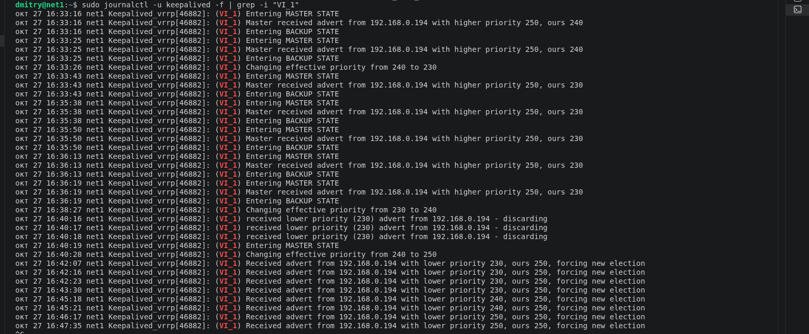

# Домашнее задание к занятию 1 «Disaster recovery и Keepalived». Студент Демин Дмитрий Александрович.

## Задание 1

    Дана схема для Cisco Packet Tracer, рассматриваемая в лекции.
    На данной схеме уже настроено отслеживание интерфейсов маршрутизаторов Gi0/1 (для нулевой группы)
    Необходимо аналогично настроить отслеживание состояния интерфейсов Gi0/0 (для первой группы).
    Для проверки корректности настройки, разорвите один из кабелей между одним из маршрутизаторов и Switch0 и запустите ping между PC0 и Server0.
    Отправьте получившуюся схему в формате pkt и скриншот, где виден процесс настройки маршрутизатора.

## Решение


## Задание 2

    Запустите две виртуальные машины Linux, установите и настройте сервис Keepalived как в лекции, используя пример конфигурационного файла.
    Настройте любой веб-сервер (например, nginx или simple python server) на двух виртуальных машинах
    Напишите Bash-скрипт, который будет проверять доступность порта данного веб-сервера и существование файла index.html в root-директории данного веб-сервера.
    Настройте Keepalived так, чтобы он запускал данный скрипт каждые 3 секунды и переносил виртуальный IP на другой сервер, если bash-скрипт завершался с кодом, отличным от нуля (то есть порт веб-сервера был недоступен или отсутствовал index.html). Используйте для этого секцию vrrp_script
    Отправьте получившейся bash-скрипт и конфигурационный файл keepalived, а также скриншот с демонстрацией переезда плавающего ip на другой сервер в случае недоступности порта или файла index.html


## Решение

### bash-скрипт
``` bash
#!/usr/bin/env bash

PORT=80
DOC_ROOT="/var/www/html"
INDEX_FILE="${DOC_ROOT}/index.nginx.html"

# Проверяем доступность порта
if ! nc -z -w 2 localhost "$PORT"; then
    exit 1
fi

# Проверяем существование index.nginx.html
if [[ ! -f "$INDEX_FILE" ]]; then
    exit 1
fi

exit 0
```
### конфигурационный файл keepalived MASTER
```
vrrp_script check_web {
    script "/usr/local/bin/check_web.sh"
    interval 3
    weight -20
    rise 2
    fall 2
}

vrrp_instance VI_1 {
    state MASTER
    interface enp0s3
    virtual_router_id 250
    priority 255
    advert_int 1

    authentication {
        auth_type PASS
        auth_pass 123456
    }

    virtual_ipaddress {
        192.168.0.250/24
    }

    track_script {
        check_web
    }
}
```

### конфигурационный файл keepalived BACKUP
```
vrrp_script check_web {
    script "/usr/local/bin/check_web.sh"
    interval 3
    weight -20
    rise 2
    fall 2
}

vrrp_instance VI_1 {
    state BACKUP
    interface enp0s3
    virtual_router_id 250
    priority 240
    advert_int 1

    authentication {
        auth_type PASS
        auth_pass 123456
    }

    virtual_ipaddress {
        192.168.0.250/24
    }

    track_script {
        check_web
    }
}
```


Дополнительные задания со звёздочкой*

Эти задания дополнительные. Их можно не выполнять. На зачёт это не повлияет. Вы можете их выполнить, если хотите глубже разобраться в материале.
## Задание 3*

    Изучите дополнительно возможность Keepalived, которая называется vrrp_track_file
    Напишите bash-скрипт, который будет менять приоритет внутри файла в зависимости от нагрузки на виртуальную машину (можно разместить данный скрипт в cron и запускать каждую минуту). Рассчитывать приоритет можно, например, на основании Load average.
    Настройте Keepalived на отслеживание данного файла.
    Нагрузите одну из виртуальных машин, которая находится в состоянии MASTER и имеет активный виртуальный IP и проверьте, чтобы через некоторое время она перешла в состояние SLAVE из-за высокой нагрузки и виртуальный IP переехал на другой, менее нагруженный сервер.
    Попробуйте выполнить настройку keepalived на третьем сервере и скорректировать при необходимости формулу так, чтобы плавающий ip адрес всегда был прикреплен к серверу, имеющему наименьшую нагрузку.
    Отправьте получившийся bash-скрипт и конфигурационный файл keepalived, а также скриншоты логов keepalived с серверов при разных нагрузках


## Решение

### bash-скрипт
``` bash
#! /bin/bash

TRACK_FILE="/var/run/keeplived_load.txt"

LOAD_1M=$(cut -d' ' -f1 /proc/loadavg)
LOAD_INT=$(LC_ALL=C printf "%.0f" "$LOAD_1M")

echo "$LOAD_INT" > "$TRACK_FILE"
exit
```
### конфигурационный файл keepalived

```
global_defs {
    enable_script_security
    script_user root
}

vrrp_script check_web {
    script "/usr/local/bin/check_web.sh"
    interval 3
    weight -160
    rise 2
    fall 2
}

vrrp_script check_load_script {
    script "/usr/local/bin/update_load_priority.sh"
    interval 60
    weight 0
}

vrrp_track_file load_tracker {
    file "/var/run/keeplived_load.txt"
    weight -10
}

vrrp_instance VI_1 {
    state MASTER
    interface enp0s3
    virtual_router_id 250
    priority 250
    advert_int 1

    authentication {
        auth_type PASS
        auth_pass 123456
    }

    virtual_ipaddress {
        192.168.0.250/24
    }

    track_script {
        check_web
        check_load_script
    }

    track_file {
        load_tracker
    }
}
```
