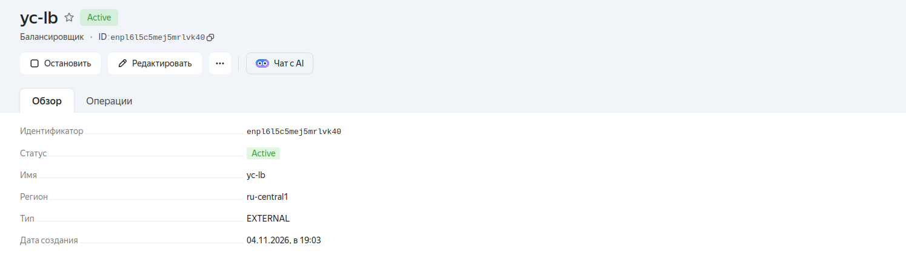
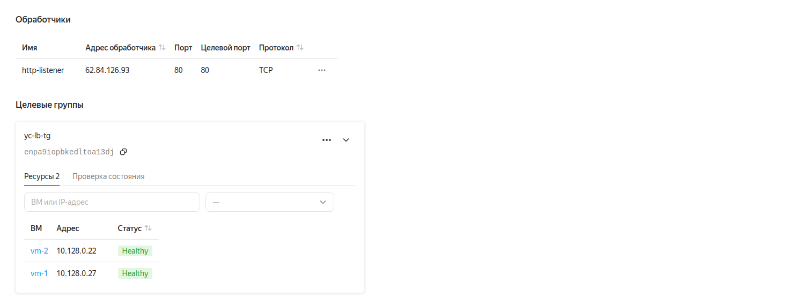
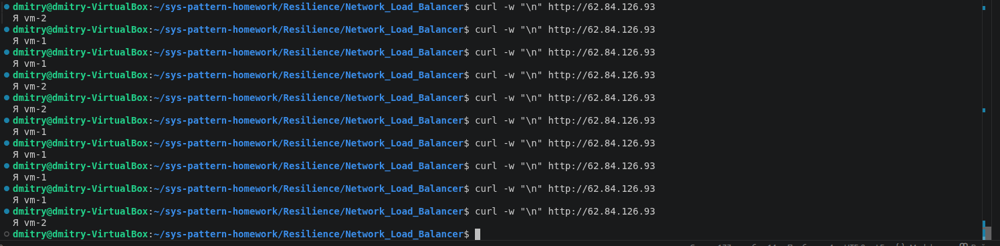

# Домашнее задание к занятию «Отказоустойчивость в облаке»

## Задание 1

Возьмите за основу решение к заданию 1 из занятия «Подъём инфраструктуры в Яндекс Облаке».

    Теперь вместо одной виртуальной машины сделайте terraform playbook, который:

    1. создаст 2 идентичные виртуальные машины. Используйте аргумент count для создания таких ресурсов;
    2. создаст таргет-группу. Поместите в неё созданные на шаге 1 виртуальные машины;
    3. создаст сетевой балансировщик нагрузки, который слушает на порту 80, отправляет трафик на порт 80 виртуальных машин и http healthcheck на порт 80 виртуальных машин.

    Установите на созданные виртуальные машины пакет Nginx любым удобным способом и запустите Nginx веб-сервер на порту 80.

    Перейдите в веб-консоль Yandex Cloud и убедитесь, что:

    1. созданный балансировщик находится в статусе Active,
    2. обе виртуальные машины в целевой группе находятся в состоянии healthy.

    Сделайте запрос на 80 порт на внешний IP-адрес балансировщика и убедитесь, что вы получаете ответ в виде дефолтной страницы Nginx.

В качестве результата пришлите:

1. Terraform Playbook.

2. Скриншот статуса балансировщика и целевой группы.

3. Скриншот страницы, которая открылась при запросе IP-адреса балансировщика.

## Решение

### main.tf
``` hcl
terraform {
  required_providers {
    yandex = {
      source  = "yandex-cloud/yandex"
      version = "0.129.0"
    }
    local = {
      source  = "hashicorp/local"
      version = ">= 2.4.0"
    }
  }
}

provider "yandex" {
  service_account_key_file = var.yc_service_account_key_file
  cloud_id                 = var.yc_cloud_id
  folder_id                = var.yc_folder_id
}

data "yandex_client_config" "client" {}

data "yandex_vpc_subnet" "default" {
  name = "default-${var.yc_zone}"
}

data "yandex_compute_image" "image" {
  family = "ubuntu-2204-lts"
}


resource "yandex_compute_instance" "vm" {
  count = 2
  name  = "vm-${count.index + 1}"
  zone  = var.yc_zone
  platform_id = "standard-v1"

  resources {
    cores  = 2
    memory = 2
    core_fraction = 20
  }

  scheduling_policy {
    preemptible = true
  }

  boot_disk {
    initialize_params {
      image_id = data.yandex_compute_image.image.id
    }
  }

  network_interface {
    subnet_id = data.yandex_vpc_subnet.default.id
    nat       = true
  }

  metadata = {
    ssh-keys = "${var.ssh_user}:${file(var.ssh_private_key_path)}"
  }
}


resource "yandex_lb_target_group" "tg" {
  name = "yc-lb-tg"

  dynamic "target" {
    for_each = yandex_compute_instance.vm
    content {
      subnet_id = data.yandex_vpc_subnet.default.id
      address   = target.value.network_interface[0].ip_address
    }
  }
}


resource "yandex_lb_network_load_balancer" "lb" {
  name = "yc-lb"

  listener {
    name = "http-listener"
    port = 80
  }

  attached_target_group {
    target_group_id = yandex_lb_target_group.tg.id

    healthcheck {
      name                = "http-health"
      interval            = 2
      timeout             = 1
      healthy_threshold   = 2
      unhealthy_threshold = 2
      http_options {
        port = 80
        path = "/"
      }
    }
  }
}


resource "local_file" "ansible_inventory" {
  filename        = "${path.module}/ansible/inventory.ini"
  file_permission = "0600"

  content = <<-EOT
[webservers]
vm-1 ansible_host=${yandex_compute_instance.vm[0].network_interface[0].nat_ip_address} ansible_user=${var.ssh_user}
vm-2 ansible_host=${yandex_compute_instance.vm[1].network_interface[0].nat_ip_address} ansible_user=${var.ssh_user}

[webservers:vars]
ansible_ssh_private_key_file=${var.ssh_private_key_path}
ansible_ssh_common_args='-o StrictHostKeyChecking=no'
EOT
}


resource "null_resource" "configure_nginx" {
  triggers = {
    inventory = local_file.ansible_inventory.content_md5
    playbook  = filemd5("${path.module}/ansible/nginx.yml")
  }

  provisioner "local-exec" {
    environment = {
      ANSIBLE_HOST_KEY_CHECKING = "False"
    }
    command = "ansible-playbook -i ${path.module}/ansible/inventory.ini ${path.module}/ansible/nginx.yml"
  }
}
```

### Cтатус балансировщика



### Cтатус целевой группы



### Скриншот страницы, которая открылась при запросе IP-адреса балансировщика

