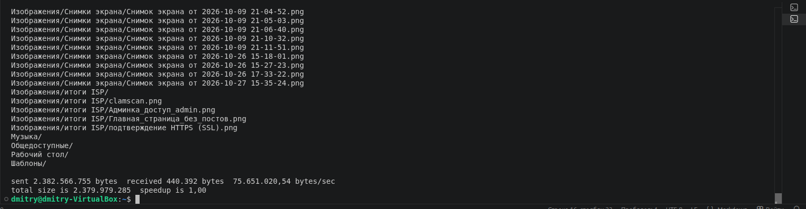
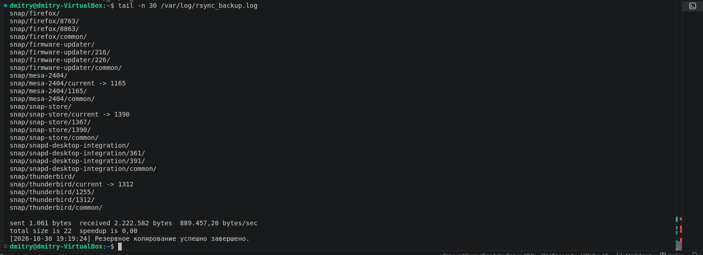
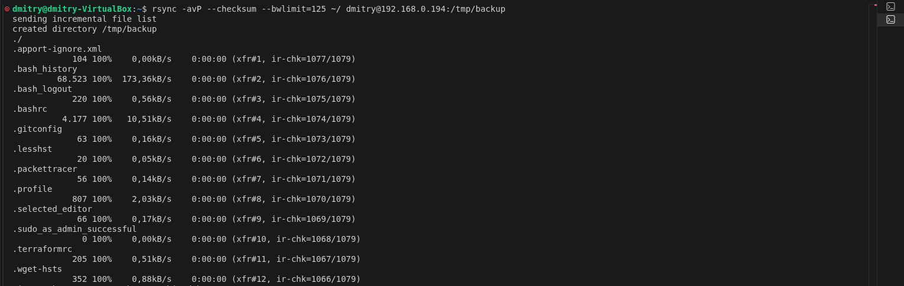
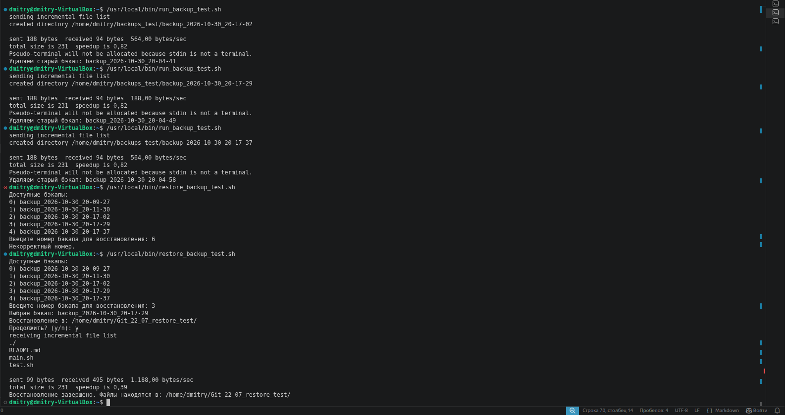

# Домашнее задание к занятию 3 «Резервное копирование»

## Задание 1

    Составьте команду rsync, которая позволяет создавать зеркальную копию домашней директории пользователя в директорию /tmp/backup
    Необходимо исключить из синхронизации все директории, начинающиеся с точки (скрытые)
    Необходимо сделать так, чтобы rsync подсчитывал хэш-суммы для всех файлов, даже если их время модификации и размер идентичны в источнике и приемнике.
    На проверку направить скриншот с командой и результатом ее выполнения

## Решение

``` bash
rsync -av --checksum --exclude=".*" ~/ /tmp/backup

```


## Задание 2

    Написать скрипт и настроить задачу на регулярное резервное копирование домашней директории пользователя с помощью rsync и cron.
    Резервная копия должна быть полностью зеркальной
    Резервная копия должна создаваться раз в день, в системном логе должна появляться запись об успешном или неуспешном выполнении операции
    Резервная копия размещается локально, в директории /tmp/backup
    На проверку направить файл crontab и скриншот с результатом работы утилиты.

## Решение

``` bash
# Edit this file to introduce tasks to be run by cron.
#
# Each task to run has to be defined through a single line
# indicating with different fields when the task will be run
# and what command to run for the task
#
# To define the time you can provide concrete values for
# minute (m), hour (h), day of month (dom), month (mon),
# and day of week (dow) or use '*' in these fields (for 'any').
#
# Notice that tasks will be started based on the cron's system
# daemon's notion of time and timezones.
#
# Output of the crontab jobs (including errors) is sent through
# email to the user the crontab file belongs to (unless redirected).
#
# For example, you can run a backup of all your user accounts
# at 5 a.m every week with:
# 0 5 * * 1 tar -zcf /var/backups/home.tgz /home/

19 15 * * * /usr/local/bin/daily_rsync_backup.sh

# For more information see the manual pages of crontab(5) and cron(8)
#
# m h  dom mon dow   command

```



Задания со звёздочкой*

Эти задания дополнительные. Их можно не выполнять. На зачёт это не повлияет. Вы можете их выполнить, если хотите глубже разобраться в материале.
## Задание 3*

    Настройте ограничение на используемую пропускную способность rsync до 1 Мбит/c
    Проверьте настройку, синхронизируя большой файл между двумя серверами
    На проверку направьте команду и результат ее выполнения в виде скриншота



## Задание 4*

    Напишите скрипт, который будет производить инкрементное резервное копирование домашней директории пользователя с помощью rsync на другой сервер
    Скрипт должен удалять старые резервные копии (сохранять только последние 5 штук)
    Напишите скрипт управления резервными копиями, в нем можно выбрать резервную копию и данные восстановятся к состоянию на момент создания данной резервной копии.
    На проверку направьте скрипт и скриншоты, демонстрирующие его работу в различных сценариях.


## Решение

### Скрипт для резервного копирования

``` bash
#!/usr/bin/env bash
set -euo pipefail

# --- НАСТРОЙКИ (под твою задачу) ---
REMOTE_USER="dmitry"
REMOTE_HOST="192.168.0.194"
REMOTE_BASE_DIR="/home/dmitry/backups_test"
SOURCE_DIR="/home/dmitry/Git_22_07/"
LOG_FILE="$HOME/rsync_backup_test.log"
MAX_BACKUPS=5

# Имя бэкапа: backup_YYYY-MM-DD_HH-MM-SS
TIMESTAMP=$(date +"%Y-%m-%d_%H-%M-%S")
BACKUP_NAME="backup_${TIMESTAMP}"
BACKUP_PATH="${REMOTE_BASE_DIR}/${BACKUP_NAME}"

# Создаём удалённую базовую директорию, если нет
ssh "${REMOTE_USER}@${REMOTE_HOST}" "mkdir -p '${REMOTE_BASE_DIR}'"

# Ищем последний существующий бэкап для --link-dest
LAST_BACKUP=$(ssh "${REMOTE_USER}@${REMOTE_HOST}" "ls -1 '${REMOTE_BASE_DIR}' | grep '^backup_' | sort | tail -n 1")

# Формируем команду rsync
if [[ -n "${LAST_BACKUP}" ]]; then
  # Есть предыдущий бэкап — делаем инкрементный через hard links
  rsync -av --delete --exclude=".*" --checksum --bwlimit=1250 \
    --link-dest="${REMOTE_BASE_DIR}/${LAST_BACKUP}" \
    "${SOURCE_DIR}" "${REMOTE_USER}@${REMOTE_HOST}:${BACKUP_PATH}"
else
  # Это первый бэкап — просто полная копия
  rsync -av --delete --exclude=".*" --checksum --bwlimit=1250 \
    "${SOURCE_DIR}" "${REMOTE_USER}@${REMOTE_HOST}:${BACKUP_PATH}"
fi

# Ротация: удаляем самые старые бэкапы, если их больше MAX_BACKUPS
ssh "${REMOTE_USER}@${REMOTE_HOST}" <<EOF
  cd '${REMOTE_BASE_DIR}' || exit 1
  # Получаем список только папок backup_*
  mapfile -t backups < <(ls -1d backup_* 2>/dev/null || true)
  count=\${#backups[@]}
  if [ "\$count" -gt ${MAX_BACKUPS} ]; then
    # Сортируем
    IFS=$'\n' sorted=\$(printf '%s\n' "\${backups[@]}" | sort)
    unset IFS
    # Удаляем все, кроме последних MAX_BACKUPS
    echo "\$sorted" | head -n -${MAX_BACKUPS} | while read -r dir; do
      # Проверяем, что это действительно папка и имеет префикс
      if [ -d "\$dir" ] && [[ "\$dir" == backup_* ]]; then
        echo "Удаляем старый бэкап: \$dir"
        rm -rf -- "\$dir"
      else
        echo "Пропускаем (не папка или не backup_): \$dir" >&2
      fi
    done
  fi
EOF

# Логирование результата
STATUS=$?
TIMESTAMP_LOG=$(date '+%Y-%m-%d %H:%M:%S')
if [[ ${STATUS} -eq 0 ]]; then
  echo "[${TIMESTAMP_LOG}] Бэкап '${BACKUP_NAME}' успешно создан." >> "${LOG_FILE}"
else
  echo "[${TIMESTAMP_LOG}] Ошибка при создании бэкапа '${BACKUP_NAME}'." >> "${LOG_FILE}"
  exit 1
fi

```

### Скрипт для востановления копий

``` bash
#!/usr/bin/env bash
set -euo pipefail

REMOTE_USER="dmitry"
REMOTE_HOST="192.168.0.194"
REMOTE_BASE_DIR="/home/dmitry/backups_test"
DEST_DIR="$HOME/Git_22_07_restore_test/"

# Создадим папку для восстановления, если нет (чтобы не ломать исходную Git_22_07)
mkdir -p "${DEST_DIR}"

# Получаем список бэкапов с удалённой машины
BACKUPS=$(ssh "${REMOTE_USER}@${REMOTE_HOST}" "ls -1 '${REMOTE_BASE_DIR}' | grep '^backup_' | sort")

if [[ -z "${BACKUPS}" ]]; then
  echo "На удалённом сервере нет бэкапов."
  exit 1
fi

echo "Доступные бэкапы:"
mapfile -t BACKUP_LIST <<< "${BACKUPS}"
for i in "${!BACKUP_LIST[@]}"; do
  echo "${i}) ${BACKUP_LIST[i]}"
done

read -p "Введите номер бэкапа для восстановления: " idx

if ! [[ "${idx}" =~ ^[0-9]+$ ]] || (( idx < 0 || idx >= ${#BACKUP_LIST[@]} )); then
  echo "Некорректный номер."
  exit 1
fi

SELECTED_BACKUP="${BACKUP_LIST[idx]}"
SELECTED_PATH="${REMOTE_BASE_DIR}/${SELECTED_BACKUP}"

echo "Выбран бэкап: ${SELECTED_BACKUP}"
echo "Восстановление в: ${DEST_DIR}"
read -p "Продолжить? (y/n): " confirm
[[ "${confirm}" != "y" && "${confirm}" != "Y" ]] && exit 0

# Восстановление: копируем из выбранного бэкапа в тестовую папку
rsync -av --delete --exclude=".*" "${REMOTE_USER}@${REMOTE_HOST}:${SELECTED_PATH}/" "${DEST_DIR}"

echo "Восстановление завершено. Файлы находятся в: ${DEST_DIR}"

```
