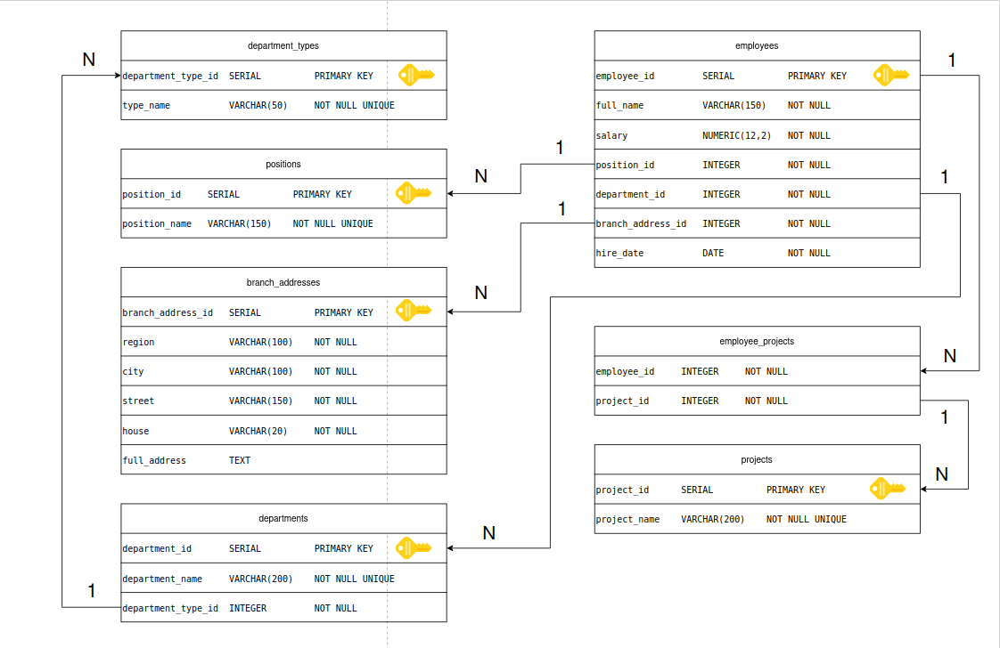
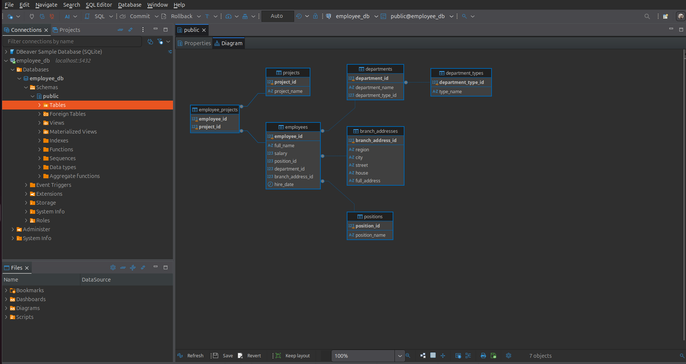

# Домашнее задание к занятию «Базы данных»

### Легенда

Заказчик передал вам [файл в формате Excel](sys-pattern-homework/rdbms_admin/db_intro/hw-12-1.xlsx), в котором сформирован отчёт.

На основе этого отчёта нужно выполнить следующие задания.

### Задание 1

Опишите не менее семи таблиц, из которых состоит база данных. Определите:

- какие данные хранятся в этих таблицах,
- какой тип данных у столбцов в этих таблицах, если данные хранятся в PostgreSQL.

Начертите схему полученной модели данных. Можете использовать онлайн-редактор: https://app.diagrams.net/

Этапы реализации:
1.	Внимательно изучите предоставленный вам файл с данными и подумайте, как можно сгруппировать данные по смыслу.
2.	Разбейте исходный файл на несколько таблиц и определите список столбцов в каждой из них.
3.	Для каждого столбца подберите подходящий тип данных из PostgreSQL.
4.	Для каждой таблицы определите первичный ключ (PRIMARY KEY).
5.	Определите типы связей между таблицами.
6.	Начертите схему модели данных.
На схеме должны быть чётко отображены:
   - все таблицы с их названиями,
   - все столбцы  с указанием типов данных,
   - первичные ключи (они должны быть явно выделены),
   - линии, показывающие связи между таблицами.

**Результатом выполнения задания** должен стать скриншот получившейся схемы базы данных.

## Ответ



## Дополнительные задания (со звёздочкой*)
Эти задания дополнительные, то есть не обязательные к выполнению. Вы можете их выполнить, если хотите глубже и шире разобраться в материале.


### Задание 2*

1. Разверните СУБД Postgres на своей хостовой машине, на виртуальной машине или в контейнере docker.
2. Опишите схему, полученную в предыдущем задании, с помощью скрипта SQL.
3. Создайте в вашей полученной СУБД новую базу данных и выполните полученный ранее скрипт для создания вашей модели данных.

В качестве решения приложите SQL скрипт и скриншот диаграммы.

Для написания и редактирования sql удобно использовать  специальный инструмент dbeaver.

## Ответ

``` sql
DROP TABLE IF EXISTS salaries_history CASCADE;
DROP TABLE IF EXISTS employee_projects CASCADE;
DROP TABLE IF EXISTS employees CASCADE;
DROP TABLE IF EXISTS projects CASCADE;
DROP TABLE IF EXISTS branch_addresses CASCADE;
DROP TABLE IF EXISTS departments CASCADE;
DROP TABLE IF EXISTS department_types CASCADE;
DROP TABLE IF EXISTS positions CASCADE;

-- 1. Типы подразделений
CREATE TABLE department_types (
    department_type_id  SERIAL          PRIMARY KEY,
    type_name           VARCHAR(50)     NOT NULL UNIQUE
);

-- 2. Должности
CREATE TABLE positions (
    position_id     SERIAL          PRIMARY KEY,
    position_name   VARCHAR(150)    NOT NULL UNIQUE
);

-- 3. Адреса филиалов (full_address вычисляется автоматически)
CREATE TABLE branch_addresses (
    branch_address_id   SERIAL          PRIMARY KEY,
    region              VARCHAR(100)    NOT NULL,
    city                VARCHAR(100)    NOT NULL,
    street              VARCHAR(150)    NOT NULL,
    house               VARCHAR(20)     NOT NULL,
    full_address        TEXT
        GENERATED ALWAYS AS (
            region || ', г. ' || city || ', ул ' || street || ', д. ' || house
        ) STORED
);

COMMENT ON COLUMN branch_addresses.full_address IS 'Полный адрес, вычисляется автоматически';

-- 4. Структурные подразделения
CREATE TABLE departments (
    department_id       SERIAL          PRIMARY KEY,
    department_name     VARCHAR(200)    NOT NULL UNIQUE,
    department_type_id  INTEGER         NOT NULL
        REFERENCES department_types(department_type_id)
        ON UPDATE CASCADE ON DELETE RESTRICT
);

CREATE INDEX idx_departments_type ON departments(department_type_id);

-- 5. Проекты
CREATE TABLE projects (
    project_id      SERIAL          PRIMARY KEY,
    project_name    VARCHAR(200)    NOT NULL UNIQUE
);

-- 6. Сотрудники
CREATE TABLE employees (
    employee_id         SERIAL          PRIMARY KEY,
    full_name           VARCHAR(150)    NOT NULL,
    salary              NUMERIC(12,2)   NOT NULL CHECK (salary > 0),
    position_id         INTEGER         NOT NULL
        REFERENCES positions(position_id)
        ON UPDATE CASCADE ON DELETE RESTRICT,
    department_id       INTEGER         NOT NULL
        REFERENCES departments(department_id)
        ON UPDATE CASCADE ON DELETE RESTRICT,
    branch_address_id   INTEGER         NOT NULL
        REFERENCES branch_addresses(branch_address_id)
        ON UPDATE CASCADE ON DELETE RESTRICT,
    hire_date           DATE            NOT NULL
);

CREATE INDEX idx_employees_position   ON employees(position_id);
CREATE INDEX idx_employees_department ON employees(department_id);
CREATE INDEX idx_employees_address    ON employees(branch_address_id);

-- 7. Связующая таблица «сотрудники — проекты»
CREATE TABLE employee_projects (
    employee_id     INTEGER     NOT NULL
        REFERENCES employees(employee_id)
        ON UPDATE CASCADE ON DELETE CASCADE,
    project_id      INTEGER     NOT NULL
        REFERENCES projects(project_id)
        ON UPDATE CASCADE ON DELETE CASCADE,
    PRIMARY KEY (employee_id, project_id)
);

CREATE INDEX idx_employee_projects_project ON employee_projects(project_id);

```

